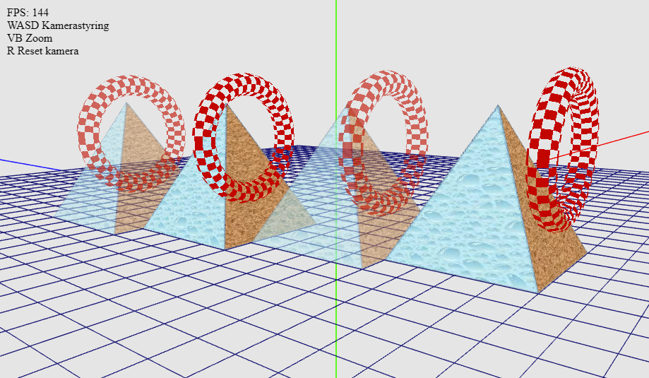

# WebGL 2 – Interactive 3D Graphics

An interactive 3D graphics application developed using JavaScript and WebGL 2 as part of my Computer Engineering studies at UiT – The Arctic University of Norway.

The project explores fundamental computer graphics concepts, including 3D geometry, transformation matrices, texture mapping, depth testing, transparency and rendering.

## Live Demo

**[Launch Interactive Demo](https://kni112.github.io/Webgl-2-demos/helloPyramid/helloPyramid.html)**

## Features

- **3D geometry:** Custom pyramid and torus meshes using vertex and index buffers.
- **Texture mapping:** UV coordinates and texture atlas mapping.
- **Transparency:** Alpha blending, depth testing and depth-buffer management.
- **Back-face culling:** Triangle winding order and face visibility.
- **Camera controls:** Interactive rotation and zoom.
- **Transformations:** Model, view and projection matrices using a matrix stack.
- **WebGL shaders:** Custom GLSL vertex and fragment shaders.

## Controls

| Key | Action |
|---|---|
| W / S | Rotate camera vertically |
| A / D | Rotate camera horizontally |
| V / B | Zoom out / in |
| R | Reset camera |

Camera position is preserved between page reloads using browser local storage.

## Technologies

- JavaScript (ES6+)
- WebGL 2
- GLSL ES 3.00
- HTML5
- glMatrix and matrix utilities

## Running Locally

Clone or download the repository and serve the project using a local HTTP server.

For example:

```bash
python -m http.server 8000
```

Then open `http://localhost:8000` in a browser.

## Learning Outcomes

This project helped me develop a better understanding of the graphics rendering pipeline, particularly how vertex data is transferred to the GPU, how UV coordinates map textures onto geometry, and how depth testing and transparency affect rendering.

## Credits

Developed as part of coursework at UiT – The Arctic University of Norway.

Some foundational WebGL utilities, textures and helper functions were provided as part of the course materials, as well as Torus geometries. The application-specific geometry, rendering logic and scene composition were developed as part of my coursework.